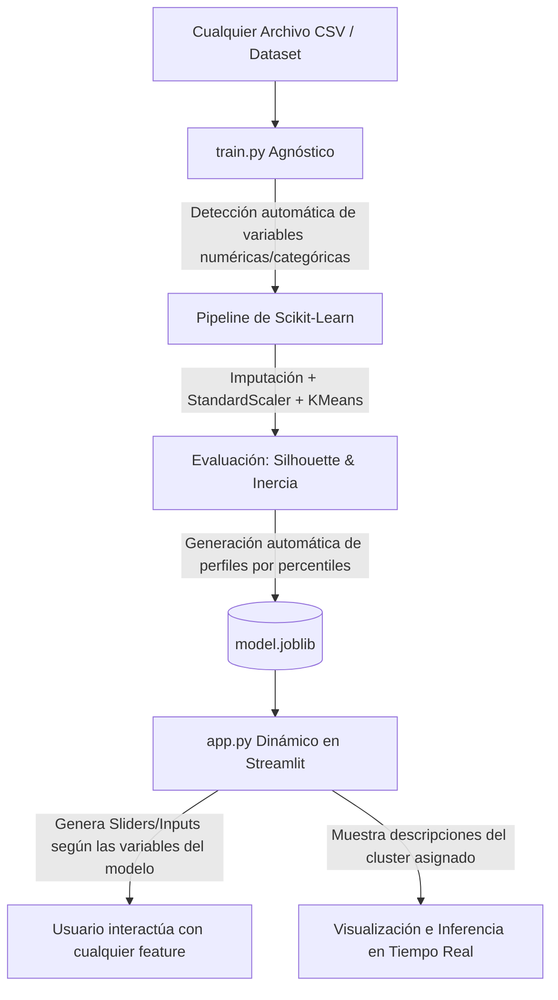

# 📋 Plan de Implementación Colaborativo - Reto Machine Learning (Ruta B: Clustering)

Este documento define la arquitectura técnica, la división de responsabilidades para el equipo de **2 integrantes**, el flujo de trabajo en **GitHub** y la estrategia de **diseño agnóstico a cualquier dataset**, en cumplimiento con las instrucciones del docente y la guía del reto.

---

## 🎯 1. Visión General y Objetivo
- **Ruta Seleccionada:** **Ruta B - Aprendizaje No Supervisado (Clustering)**.
- **Caso Base Demostrativo:** Dataset de Minifiguras de LEGO (`lego_minifigures_1975_2025.csv`).
- **Principio Fundamental:** **Arquitectura 100% Adaptable y Agnóstica**. El pipeline de entrenamiento y la aplicación web deben ser capaces de procesar, entrenar, perfilar y desplegar **cualquier dataset tabular** que se proporcione en el futuro, sin modificar el código fuente del frontend ni romper el despliegue.

---

## 🧩 2. Principio Clave: Arquitectura Agnóstica a Cualquier Dataset

Para cumplir con la instrucción del profesor (*"debe servir con cualquier dataset que se suba"*), se implementa un diseño desacoplado mediante un **Contrato de Artefacto Dinámico (`model.joblib`)**:



### Reglas de Diseño Agnóstico:
1. **Detección Automática de Features (`train.py`):**
   - El script identifica automáticamente las columnas numéricas relevantes para clustering (excluyendo IDs, URLs o campos de texto libre no numéricos).
   - Puede recibir por argumento CLI o variable de entorno la ruta del dataset (ej: `python train.py --data data/nuevo_dataset.csv`).
2. **Preprocesamiento Universal:**
   - Inclusión obligatoria de `SimpleImputer` (mediana) y `StandardScaler` en el `Pipeline` para garantizar que variables en diferentes escalas no sesguen las distancias euclidianas.
3. **Perfilamiento Semántico Automático:**
   - Si no se proporcionan nombres manuales, el sistema calcula si cada cluster está por encima (*Alto*), en el promedio (*Estándar*) o por debajo (*Bajo*) de la media general en cada magnitud, asignando etiquetas interpretables de forma automatizada.
4. **Frontend Adaptable (`app.py`):**
   - La interfaz de Streamlit **no tiene inputs quemados (*hardcoded*)**.
   - Lee la lista `numeric_features` y los rangos `(min, max, median)` guardados en `model.joblib` y genera dinámicamente los controles interactivos para cualquier dataset.

---

## 👥 3. Distribución de Trabajo (Equipo de 2 Integrantes)

Para maximizar la productividad y permitir avances simultáneos sin bloqueos mutuos, el proyecto se divide en dos roles complementarios:

```
┌──────────────────────────────────────────────┐    ┌──────────────────────────────────────────────┐
│        🧑‍💻 INTEGRANTE 1: ML & PIPELINE       │    │     🛠️ INTEGRANTE 2: FRONTEND & DEVOPS       │
├──────────────────────────────────────────────┤    ├──────────────────────────────────────────────┤
│ • Ingesta y Feature Engineering agnóstico    │    │ • app.py reactivo y adaptable en Streamlit   │
│ • Selección óptima de k (Elbow & Silhouette) │    │ • requirements.txt, Dockerfile, .dockerignore│
│ • train.py modular y reproducible            │    │ • Pruebas locales de contenedor Docker       │
│ • Generación del contrato model.joblib       │    │ • Despliegue en GCP Compute Engine (:8501)   │
│ • Documentación analítica y métricas en README│    │ • Guía de despliegue y prueba cruzada en README│
└──────────────────────────────────────────────┘    └──────────────────────────────────────────────┘
```

### 🧑‍💻 Integrante 1: Especialista en Modelado y Pipeline de Datos (ML Engineer)
- **Foco:** El motor matemático y la reproducibilidad del entrenamiento.
- **Entregables específicos:**
  1. **Preparación de Datos:** Estructurar la carpeta `data/` y asegurar la compatibilidad con el dataset de LEGO y datasets alternativos.
  2. **Pipeline de Scikit-Learn:** Crear `train.py` utilizando `Pipeline([('imputer', ...), ('scaler', ...), ('cluster', KMeans(...))])`.
  3. **Evaluación no supervisada:** Calcular métricas objetivas (Inercia, Coeficiente de Silueta) para justificar la elección de $k$.
  4. **Serialización del Artefacto:** Guardar en `model.joblib` un diccionario estándar:
     ```python
     artifact = {
         "model": pipeline,
         "features": numeric_features,
         "feature_stats": stats_dict,  # min, max, mean, median para inputs
         "task": "clustering",
         "k": n_clusters,
         "silhouette_score": score,
         "cluster_descriptions": descriptions,
         "cluster_profiles": profiles_df
     }
     ```
  5. **Documentación:** Explicar el preprocesamiento, métricas e interpretación de los clusters en el `README.md`.

---

### 🛠️ Integrante 2: Especialista en Producto, Frontend y DevOps (Cloud Engineer)
- **Foco:** La experiencia de usuario, contenedorización y disponibilidad en la nube.
- **Entregables específicos:**
  1. **Interfaz Web Adaptable (`app.py`):** Construir una aplicación en Streamlit que inspeccione `model.joblib` y dibuje controles para cualquier variable entrante, mostrando la predicción del clúster, su perfil y gráficos de distribución.
  2. **Entorno Reproducible:** Redactar `requirements.txt` con versiones compatibles y estables.
  3. **Contenedorización (`Dockerfile` y `.dockerignore`):** Diseñar una imagen ligera en Python exponiendo el puerto `8501` y configurando el arranque hacia `0.0.0.0`.
  4. **Despliegue en GCP:**
     - Creación de la instancia VM en Compute Engine.
     - Configuración de la regla de cortafuegos en Google Cloud (`allow-streamlit-8501`).
     - Ejecución del contenedor en producción con reinicio automático (`--restart unless-stopped`).
  5. **Guía de Reproducibilidad:** Documentar paso a paso los comandos exactos para la **prueba cruzada** con otra pareja.

---

## 🌿 4. Estrategia de Colaboración en Git y GitHub

Para asegurar visibilidad total y evitar conflictos de código:

### A. Política de Ramas
- `main`: Rama de producción. Solo contiene código integrado y probado. **Prohibido realizar commits directos de código no probado.**
- `feature/ml-pipeline`: Rama de trabajo del Integrante 1 (datos, `train.py`, `model.joblib`).
- `feature/app-and-docker`: Rama de trabajo del Integrante 2 (`app.py`, `Dockerfile`, GCP).

### B. El Hito de Sincronización (*El Contrato de Artefacto*)
1. En las primeras etapas, el Integrante 1 crea y sube una versión base de `model.joblib` a su rama o a `main`.
2. El Integrante 2 toma ese `model.joblib` de referencia para desarrollar y validar `app.py` y el `Dockerfile` sin esperar a que el modelo definitivo esté terminado.
3. Cualquier cambio en las variables se comunica y se prueba de forma transparente porque el frontend está programado para ser auto-adaptativo.

### C. Proceso de Integración (Pull Requests)
1. Cada integrante sube sus avances a su respectiva rama remota:
   ```bash
   git push origin feature/<nombre-de-rama>
   ```
2. Se abre un **Pull Request (PR)** en GitHub hacia `main`.
3. El otro compañero revisa el código, valida que funcione y aprueba el *merge*.

---

## 🚀 5. Cronograma de Fases

| Fase | Duración Estimada | Entregable Clave |
| :--- | :--- | :--- |
| **Fase 1: Preparación y Contrato** | Día 1 | `data/` estructurado, primer borrador de `train.py` y `model.joblib` semilla. |
| **Fase 2: Desarrollo Paralelo** | Días 1-2 | Int. 1: `train.py` definitivo y cálculo de silueta.<br>Int. 2: `app.py` dinámico y `Dockerfile`. |
| **Fase 3: Integración y Docker Local** | Día 2 | `docker build` y `docker run` validados en local con el modelo final. |
| **Fase 4: Despliegue en GCP** | Día 3 | VM en Compute Engine activa, firewall abierto y app accesible por IP pública. |
| **Fase 5: README y Prueba Cruzada** | Día 3 | Validación de reproducibilidad con otra pareja de estudiantes. |

---

## 🧪 6. Validación de Adaptabilidad a Nuevos Datasets

Para comprobar que el proyecto cumple con la directriz del profesor:
1. **Prueba 1 (Lego Base):**
   ```bash
   python train.py --data lego_minifigures_1975_2025.csv
   streamlit run app.py
   ```
2. **Prueba 2 (Cualquier otro dataset CSV):**
   ```bash
   python train.py --data ruta/a/otro_dataset.csv
   streamlit run app.py
   ```
   *Resultado esperado:* La app se abrirá sin errores, adaptando los controles a las nuevas variables numéricas del dataset secundario.
